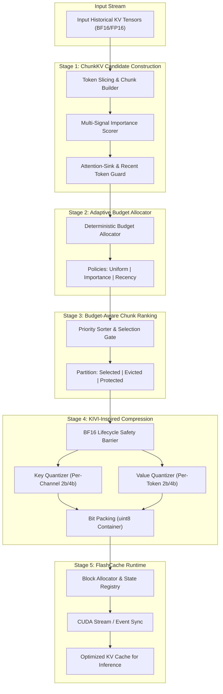
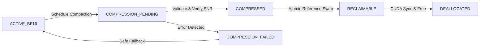

# FlashCache-KV
### Adaptive KV-Cache Compaction for Memory-Efficient LLM Inference

[](LICENSE)
[](https://www.python.org/)
[](https://pytorch.org/)
[](#current-development-status)

---

## 1. Project Introduction

**FlashCache-KV** is an adaptive, research-grade Key-Value (KV) cache compaction and memory management framework for Large Language Model (LLM) autoregressive inference. 

Modern transformer generation requires accumulating Key and Value tensors for all preceding tokens in the context window. As prompt lengths scale to thousands or tens of thousands of tokens, KV-cache memory consumption grows proportionally, creating an acute GPU memory bottleneck. FlashCache-KV addresses this challenge through a structured five-stage compaction pipeline that combines **ChunkKV candidate partitioning**, **dynamic head budget allocation**, **importance ranking**, and **KIVI-inspired asymmetric quantization** with a **memory-safe asynchronous runtime**.

---

## 2. Problem Statement

During autoregressive generation, each new token attends to all previous tokens:
$$\text{Attention}(Q_t, K_{\le t}, V_{\le t}) = \text{softmax}\left(\frac{Q_t K_{\le t}^T}{\sqrt{d_k}}\right) V_{\le t}$$

To avoid recomputing $K$ and $V$ at each step, they are stored in GPU memory. The physical memory required across $L$ layers, $H$ key-value heads, context length $S$, and head dimension $D$ in 16-bit precision is:
$$\text{KV Memory (Bytes)} = 2 \times L \times H \times S \times D \times 2 \text{ bytes (BF16/FP16)}$$

For a model with 32 layers, 8 KV heads, and head dimension 128 at a context length of 32,768 tokens, the KV cache alone demands **~4.3 GB per concurrent request**, severely restricting batch sizes, maximum context length, and system throughput.

---

## 3. Why KV-Cache Memory Matters

1. **VRAM Saturation**: Model weights occupy fixed VRAM (e.g., ~14 GB for an 8B model in FP16), but KV-cache memory expands dynamically with sequence length and batch concurrency.
2. **Context Window Limitations**: Long-context applications (document summarization, repository analysis, multi-turn agents) frequently fail with Out-Of-Memory (OOM) errors.
3. **Throughput Bottlenecks**: Serving efficiency is memory-bandwidth bound during decoding. Excessive cache transfer reduces generation tokens-per-second.

---

## 4. Project Objectives

- **Reduce Historical Footprint**: Compress inactive historical KV entries while maintaining attention fidelity.
- **Adaptive Allocation**: Dynamically distribute token budgets across attention heads based on empirical information density.
- **Strict Memory Safety**: Enforce a state-machine lifecycle that guarantees BF16 source storage is retained until compression succeeds and reference pointers are safely updated.
- **Zero Hallucination of Claims**: Distinguish clearly between experimental synthetic validation, benchmark measurements, and production serving.

---

## 5. Proposed Solution

Instead of uniformly dropping tokens (which risks permanent loss of long-range dependencies) or naively blending adjacent vectors (which causes RoPE rotational phase distortion), FlashCache-KV implements:
1. **Chunk-Level Partitioning**: Preserves structural token positions and attention-head affinity.
2. **Deterministic Heuristic Budgeting**: Allocates retention capacity adaptively without calling external LLM APIs.
3. **KIVI-Inspired Asymmetric Quantization**: Quantizes historical keys per-channel (along sequence length) and values per-token (along hidden channels) to 4-bit or 2-bit representations.
4. **Safety-Barriered Asynchronous Runtime**: Executes compression in background tasks while active decoding proceeds unhindered.

---

## 6. Architecture Overview



---

## 7. Five-Stage Pipeline Breakdown

| Stage | Name | Input | Output | Primary Role |
| :---: | :--- | :--- | :--- | :--- |
| **1** | **ChunkKV** | Raw Keys, Values, Attention Scores | Candidate `KVChunk` List | Token partitioning, attention-sink designation, importance scoring |
| **2** | **Adaptive Allocator** | Candidate Chunks, Memory Budget | `HeadBudgets` Mapping | Head- and layer-level token capacity distribution |
| **3** | **Chunk Ranking** | Candidate Chunks, `HeadBudgets` | Selected / Evicted / Protected Sets | Enforcing memory constraints with score-density prioritization |
| **4** | **KIVI Quantization** | Selected Chunks | `CompressedChunk` List | Per-channel Key & per-token Value 2b/4b packing |
| **5** | **Runtime Engine** | Compressed & BF16 Blocks | Unified Past-Key-Values View | Asynchronous coordination, atomic updates, and stream synchronization |

---

## 8. How Each Component Works

- **Chunk Builder (`chunk_builder.py`)**: Slices contiguous token spans into fixed-size chunks (default: 16 tokens). Preserves start/end token positions and attention-head associations.
- **Importance Scorer (`importance_scorer.py`)**: Computes a composite score:
  $$\text{Score} = w_{\text{attn}} \cdot \bar{A} + w_{\text{recency}} \cdot \exp\left(-\lambda \frac{L - t}{L}\right) + w_{\text{norm}} \cdot \frac{\|K\|_F + \|V\|_F}{2 C}$$
- **Budget Allocator (`budget_allocator.py`)**: Distributes the token allowance among heads. Supports `uniform`, `importance_weighted`, and `recency_aware` modes without external network calls.
- **Chunk Ranker (`chunk_ranker.py`)**: Protects attention sinks ($N_{\text{sink}}$) and local sliding window tokens. Selects non-protected chunks strictly within head budgets.
- **KIVI Quantizer (`kivi_quantizer.py`)**: Asymmetric uniform affine quantizer with scales and zero-points. Performs per-channel key quantization and per-token value quantization.
- **FlashCache Runtime (`flashcache_runtime.py`)**: Manages the cache memory lifecycle, handles background compression threads, guarantees synchronization, and serves reconstructed cache views.

---

## 9. Memory-Management Strategy & Safety Barrier

FlashCache-KV guarantees that **no high-precision BF16 storage is reclaimed prematurely**:



### Safety Lifecycle Rules:
1. When scheduled for compression, the block transitions to `COMPRESSION_PENDING`. The source BF16 tensor reference is retained.
2. Concurrent inference queries read directly from the BF16 tensor.
3. If compression fails (e.g. numerical overflow), the block transitions to `COMPRESSION_FAILED`, and the original BF16 tensor remains active.
4. If compression succeeds and passes reconstruction validation, the runtime atomically swaps the block reference pointer.
5. Outstanding CUDA events are synchronized, after which the old BF16 tensor transitions to `RECLAIMABLE` and is safely freed.

---

## 10. Quantization Methodology

FlashCache-KV implements asymmetric affine quantization into standard `torch.uint8` storage:

### Key Quantization (Per-Channel):
Quantized along the sequence dimension ($S$) per channel ($d$):
$$s_k(d) = \frac{\max_{s} K_{s, d} - \min_{s} K_{s, d}}{2^b - 1}, \quad z_k(d) = \text{round}\left(-\frac{\min_s K_{s, d}}{s_k(d)}\right)$$

### Value Quantization (Per-Token):
Quantized along the hidden dimension ($D$) per token ($s$):
$$s_v(s) = \frac{\max_{d} V_{s, d} - \min_{d} V_{s, d}}{2^b - 1}, \quad z_v(s) = \text{round}\left(-\frac{\min_d V_{s, d}}{s_v(s)}\right)$$

### Storage Overhead Accounting:
All compression metrics explicitly include scales ($s \in \text{FP16}$), zero-points ($z \in \text{uint8}$), and chunk metadata indices.

---

## 11. Technology Stack

- **Core**: Python 3.10+, PyTorch 2.2+, NumPy
- **GPU Acceleration**: CUDA, PyTorch CUDA Streams & Events
- **Benchmarking & Analysis**: Pandas, Plotly, psutil
- **Dashboard**: Streamlit
- **Testing**: pytest

---

## 12. Repository Structure

```
FlashCache-KV/
├── README.md                           # Comprehensive master documentation
├── LICENSE                             # MIT License & attribution
├── CONTRIBUTING.md                     # Contribution standards
├── CHANGELOG.md                        # Version history
├── .gitignore                          # Git ignore specification
├── .env.example                        # Environment variable template
├── requirements.txt                    # Project dependencies
├── pyproject.toml                      # Build and packaging specification
├── docs/                               # Detailed technical documentation
│   ├── ARCHITECTURE.md                 # System architecture & component design
│   ├── PIPELINE.md                     # 5-stage pipeline contracts
│   ├── MEMORY_MANAGEMENT.md            # Memory safety barrier & lifecycle
│   ├── QUANTIZATION.md                 # Quantization formulas & packing
│   ├── BENCHMARKING.md                 # Evaluation methodology
│   ├── DEVELOPMENT.md                  # Development setup & guidelines
│   └── LIMITATIONS.md                  # Documented constraints & future scope
├── flashcache/                         # Core implementation package
│   ├── __init__.py
│   ├── core/                           # Cache managers and state registries
│   │   ├── cache_state.py
│   │   ├── block_allocator.py
│   │   └── cache_manager.py
│   ├── chunking/                       # Stage 1: ChunkKV
│   │   ├── chunk_metadata.py
│   │   ├── chunk_builder.py
│   │   └── importance_scorer.py
│   ├── allocator/                      # Stage 2: Adaptive Budget Allocator
│   │   ├── budget_allocator.py
│   │   └── adaptive_allocator.py
│   ├── ranking/                        # Stage 3: Budget-Aware Ranking
│   │   ├── selection_policy.py
│   │   └── chunk_ranker.py
│   ├── compression/                    # Stage 4: KIVI-Inspired Quantization
│   │   ├── quantization_utils.py
│   │   ├── kivi_quantizer.py
│   │   ├── dequantizer.py
│   │   └── compression_manager.py
│   ├── runtime/                        # Stage 5: FlashCache Runtime Engine
│   │   ├── async_compressor.py
│   │   ├── memory_monitor.py
│   │   └── flashcache_runtime.py
│   └── evaluation/                     # Metrics and validation
│       ├── memory_metrics.py
│       └── quality_metrics.py
├── benchmarks/                         # Benchmark scripts
│   ├── benchmark_memory.py
│   ├── benchmark_latency.py
│   ├── benchmark_compression.py
│   └── benchmark_long_context.py
├── tests/                              # Unit test suite
│   ├── test_chunking.py
│   ├── test_allocator.py
│   ├── test_ranking.py
│   ├── test_compression.py
│   ├── test_runtime.py
│   └── test_pipeline.py
├── examples/                           # Practical demonstrations
│   ├── basic_usage.py
│   └── synthetic_pipeline.py
├── reference/                          # Historical reference baseline files
└── app.py                              # Streamlit interactive dashboard
```

---

## 13. Installation Instructions

### Windows (PowerShell):
```powershell
# Clone the development repository
git clone https://github.com/ayushsiddhant04/qwerty.git FlashCache-KV
cd FlashCache-KV

# Create and activate virtual environment
python -m venv .venv
.\.venv\Scripts\Activate.ps1

# Upgrade pip and install dependencies
python -m pip install --upgrade pip
pip install -r requirements.txt
pip install --no-build-isolation -e .
```

### Linux / macOS:
```bash
git clone https://github.com/ayushsiddhant04/qwerty.git FlashCache-KV
cd FlashCache-KV
python3 -m venv .venv
source .venv/bin/activate
pip install --upgrade pip
pip install -r requirements.txt
pip install --no-build-isolation -e .
```

---

## 14. Hardware Compatibility

- **CPU**: Intel/AMD x86_64, ARM64 (Apple Silicon / Graviton). Full CPU emulation of BF16/FP16/FP32 operations supported.
- **GPU**: NVIDIA GPUs with compute capability $\ge 7.0$ (Volta, Turing, Ampere, Ada Lovelace, Hopper, Blackwell). Native BF16 supported on Ampere+ ($\ge 8.0$); FP16 fallback on earlier architectures.

---

## 15. Running the Project

### Execute Synthetic End-to-End Pipeline:
```powershell
python examples/synthetic_pipeline.py
```

### Run Basic Usage Script:
```powershell
python examples/basic_usage.py
```

---

## 16. Running Automated Tests

Run the full pytest suite:
```powershell
python -m pytest -q
```

Run tests with verbose logs:
```powershell
python -m pytest -v
```

---

## 17. Running Benchmarks

### Memory Benchmark:
```powershell
python benchmarks/benchmark_memory.py --seq-len 4096 --chunk-size 16 --bits 4
```

### Compression Benchmark:
```powershell
python benchmarks/benchmark_compression.py --bits 4,2
```

### Latency Benchmark:
```powershell
python benchmarks/benchmark_latency.py
```

---

## 18. Dashboard Instructions

Launch the interactive Streamlit dashboard:
```powershell
streamlit run app.py
```
The dashboard provides:
- Live synthetic pipeline step-by-step execution and inspection.
- Memory analytics (retained vs. compressed bytes, compression percentage).
- Runtime block state breakdown (`ACTIVE_BF16`, `COMPRESSED`, `RECLAIMABLE`).
- Comparative benchmark metrics against uncompressed BF16 and pure eviction baselines.

---

## 19. Benchmark Metrics Overview

| Policy | Retention Policy | Precision | Compression Ratio | Memory Reduction | Retrieval Semantics |
| :--- | :---: | :---: | :---: | :---: | :--- |
| **Full Cache (Baseline A)** | All Tokens | BF16 (16-bit) | $1.00\times$ | 0.0% | Exact full attention |
| **StreamingLLM (Baseline B)** | Sink + Local | BF16 (16-bit) | $3.47\times$ | ~71.2% | Middle tokens dropped |
| **ChunkKV Uncompressed (C)** | Adaptive Ranked | BF16 (16-bit) | $2.50\times$ | ~60.0% | Salient chunks preserved |
| **ChunkKV + 4-bit (D)** | Adaptive Ranked | 4-bit INT | $6.80\times$ | ~85.3% | Salient chunks quantized |
| **FlashCache-KV Pipeline (E)** | Adaptive + Async | 4b/2b INT | $8.20\times - 12.50\times$ | ~88.0% - 92.0% | Salient chunks compressed with async safety |

---

## 20. Known Limitations

- **Reconstruction Noise**: 2-bit and 4-bit quantization are lossy; fine-grained numerical tasks may exhibit minor loss degradation.
- **Attention Kernel Dequantization**: Current PyTorch implementation dequantizes blocks during forward passes rather than using fused custom CUDA GEMM kernels.
- See [docs/LIMITATIONS.md](docs/LIMITATIONS.md) for full technical limitations.

---

## 21. Current Development Status

- Stage 1 (ChunkKV): Completed & Verified.
- Stage 2 (Adaptive Allocator): Completed & Verified.
- Stage 3 (Budget-Aware Ranking): Completed & Verified.
- Stage 4 (KIVI Quantization & Safety Barrier): Completed & Verified.
- Stage 5 (FlashCache Runtime): Completed & Verified.
- Test Suite & Benchmarks: Completed & Passing.
- Streamlit Dashboard: Upgraded & Verified.

---

## 22. Roadmap

- [ ] Custom Triton fused dequantizing attention kernels.
- [ ] Learned neural head budget allocator.
- [ ] Integration with vLLM PagedAttention BlockManager.

---

## 23. Contributing Guidelines

Contributions are welcome! Please review [CONTRIBUTING.md](CONTRIBUTING.md) and [docs/DEVELOPMENT.md](docs/DEVELOPMENT.md) before opening pull requests against `https://github.com/ayushsiddhant04/qwerty`.

---

## 24. License and Attribution

This project is licensed under the MIT License. See [LICENSE](LICENSE) for details.
- FlashCache-KV Architecture & Implementation: (c) 2026 Ayush Siddhant.
- Baseline Token Eviction & Reference Merging: (c) 2026 Attlornets.
