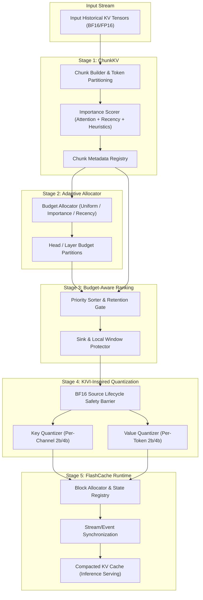
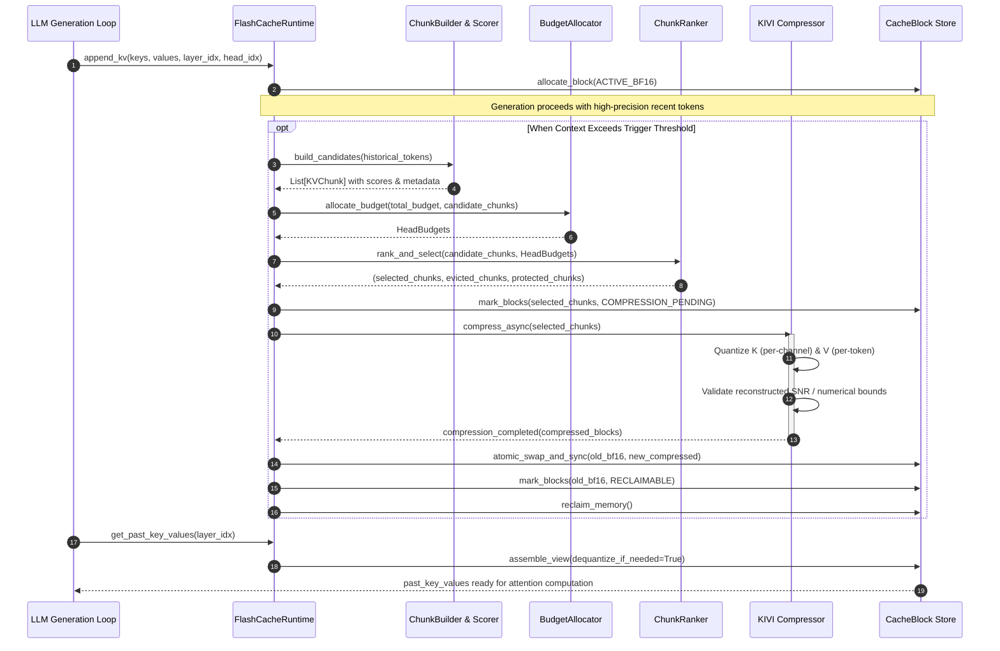

# FlashCache-KV Architecture Specification

## 1. System Vision and Objectives

**FlashCache-KV** is an adaptive, research-grade Key-Value (KV) cache compaction and memory management system designed for autoregressive Large Language Model (LLM) inference. 

In standard transformer decoding, historical Key and Value representations are accumulated for every context token across all attention heads and layers. For long sequence lengths ($L \ge 4096$), the memory footprint of these historical KV tensors scales linearly with $O(L)$, resulting in massive GPU VRAM consumption that constrains concurrency, increases latency, and risks Out-Of-Memory (OOM) failures.

FlashCache-KV resolves this bottleneck through a **five-stage modular compaction pipeline** that couples token chunking, adaptive retention budgeting, importance ranking, and KIVI-inspired asymmetric quantization with a **memory-safe asynchronous runtime**.

---

## 2. Five-Stage Pipeline Responsibilities

### Stage 1: ChunkKV — Candidate Construction
- **Responsibility**: Organizes contiguous sequences of historical KV tokens into discrete, manageable blocks ("chunks").
- **Preservation**: Retains absolute sequence positions, head identifiers, and original numerical data types.
- **Signals**: Calculates chunk-level importance metrics combining attention weights (if provided by the model backend), exponential recency decay, and positional heuristics.
- **Attention Sinks**: Automatically designates initial prompt tokens ($0 \dots \text{sink\_tokens}-1$) as protected attention sinks that are exempted from aggressive eviction or degradation.

### Stage 2: Adaptive KV Budget Allocation
- **Responsibility**: Computes dynamic token-retention budgets per attention head or allocation unit based on global memory limits and candidate distributions.
- **Strategies**:
  - `Uniform`: Divides available token capacity symmetrically across all active KV heads.
  - `Importance-Weighted`: Dynamically directs more token budget to heads displaying high dispersion or peak attention mass.
  - `Recency-Aware`: Biases budget toward deeper layers and heads sensitive to immediate conversational context.
- **Invariance**: Guaranteed deterministic execution without calling external cloud LLM APIs.

### Stage 3: Budget-Aware Chunk Ranking
- **Responsibility**: Solves the constrained selection problem for historical chunks under Stage 2's head budgets.
- **Policies**:
  - Unconditionally preserves sink tokens and local sliding window tokens.
  - Ranks remaining intermediate chunks by normalized score-to-memory density.
  - Explicitly segregates chunks into `SELECTED`, `EVICTED`, and `PROTECTED` groups with full audit logging.

### Stage 4: KIVI-Inspired Compression
- **Responsibility**: Compresses retained historical chunks using asymmetric uniform affine quantization.
- **Key Quantization**: Per-channel grouping along the sequence axis to mitigate outlier dimensions.
- **Value Quantization**: Per-token grouping along hidden dimensions to reflect token-wise variance.
- **Precision Modes**: 2-bit packed, 4-bit packed, or pass-through BF16/FP16 for sensitive tokens.
- **Critical Memory Safety**: Original BF16 storage is **never reclaimed** until the compressed representation is generated, validated for numerical sanity, atomically updated in the runtime, and synchronized across CUDA execution streams.

### Stage 5: FlashCache Runtime
- **Responsibility**: Serves as the operational orchestrator for memory allocation, block state transitions, asynchronous worker dispatch, and dequantized cache access.
- **Device Support**: Hardware-aware execution with automated CUDA stream synchronization when available and CPU emulation fallback.
- **Accounting**: Tracks precise physical tensor storage, metadata overhead, active high-precision blocks, and compression efficiency.

---

## 3. Component Interaction and Tensor Flow

---

## 4. Architectural Guarantees

1. **Non-Destructive Failure Mode**: If any quantization kernel encounters an exception or fails reconstruction checks, the block transitions to `COMPRESSION_FAILED` and the original `ACTIVE_BF16` tensor remains the primary reference. No corrupted cache is ever returned to the model.
2. **Positional Fidelity**: Unlike naive adjacent vector merging which introduces RoPE phase distortion, FlashCache preserves exact token position indices through chunk metadata and individual vector dequantization.
3. **No Unaccounted Memory**: Memory calculations strictly aggregate data buffers, quantization scales, zero-points, and tracking indices.

