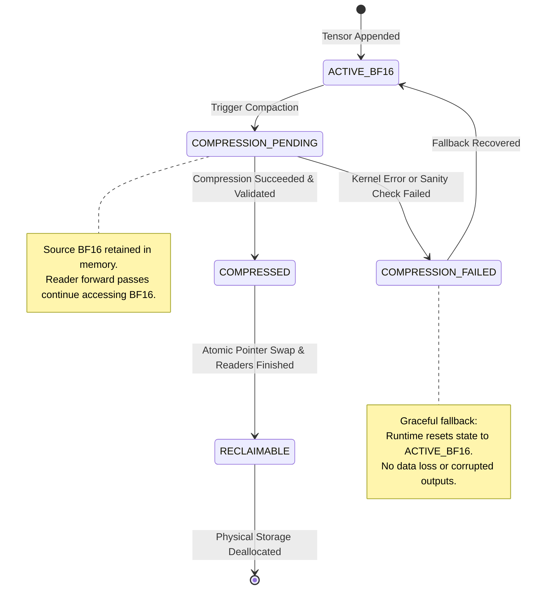

# FlashCache-KV Memory Management Specification

## 1. The Core Memory Safety Challenge

In high-throughput LLM serving systems, asynchronous background cache compaction introduces race hazards between reader threads (attention forward passes) and writer threads (quantization and compaction kernels). 

Reclaiming original high-precision (BF16/FP16) tensor memory before compression completes—or during numerical corruption—leads to segmentation faults, silent inference hallucinations, or stale pointer reads.

FlashCache-KV implements an **explicit, state-machine driven memory safety barrier** guaranteeing that source storage is retained until the compressed representation is verified and atomically published.



---

## 2. Block State Machine Definitions

| State | Storage Status | Reader Behavior | Transition Condition |
| :--- | :--- | :--- | :--- |
| `ACTIVE_BF16` | Source BF16 allocated | Reads high-precision BF16 directly | Initial creation or compression failure fallback |
| `COMPRESSION_PENDING` | Source BF16 locked; compressed buffer in synthesis | Reads high-precision BF16 directly | Compaction pass scheduled |
| `COMPRESSED` | Both source BF16 and compressed buffers exist | Reads compressed (dequantizing on-the-fly) | Quantization validation check passes |
| `COMPRESSION_FAILED` | Source BF16 retained | Reads high-precision BF16 | Quantization kernel exception or NaN check |
| `RECLAIMABLE` | Source BF16 ready for deallocation | Readers use compressed buffer | CUDA events synchronized; no outstanding readers |

---

## 3. Step-by-Step Lifecycle Contract

1. **Mark as Compression Pending**:
   The runtime updates the block state to `COMPRESSION_PENDING`. An explicit Python reference count to the underlying `torch.Tensor` is incremented.
2. **Retain Valid Source Tensor**:
   The source BF16 tensor remains fully queryable by concurrent forward passes.
3. **Dispatch Quantization**:
   The chunk is compressed into 2-bit or 4-bit packed integer buffers with associated scales and zero points.
4. **Produce and Validate**:
   The compressed chunk is verified for:
   - Buffer byte size matching expected packed dimensions.
   - Absence of `inf`, `-inf`, or `NaN` in scales and zero points.
   - Dequantization sanity: reconstructed signal-to-quantization-noise ratio (SQNR) $\ge \tau_{\text{snr}}$.
5. **Atomic Pointer Hand-off**:
   Under a thread-safe mutex or lock-free reference replacement, the active block representation pointer is redirected from BF16 to the compressed buffer.
6. **CUDA Synchronization**:
   When running on GPU, a `torch.cuda.Event` recorded after the compression stream completes is synchronized with the primary compute stream:
   ```python
   compaction_event.record(compaction_stream)
   compute_stream.wait_event(compaction_event)
   ```
7. **Safe Memory Reclamation**:
   Only after step 6 completes is the source tensor marked `RECLAIMABLE` and its reference released to Python/PyTorch memory pools (`torch.cuda.empty_cache()` where appropriate).

---

## 4. Failure Recovery Guarantee

If an unexpected tensor dimension, device mismatch, or numerical overflow occurs:
- The error is captured in `ChunkMetadata.error_log`.
- The block state transitions to `COMPRESSION_FAILED`.
- The compressed artifact is discarded.
- The active reference continues pointing to the original `ACTIVE_BF16` tensor.
- Inference proceeds uninterrupted with full accuracy.
